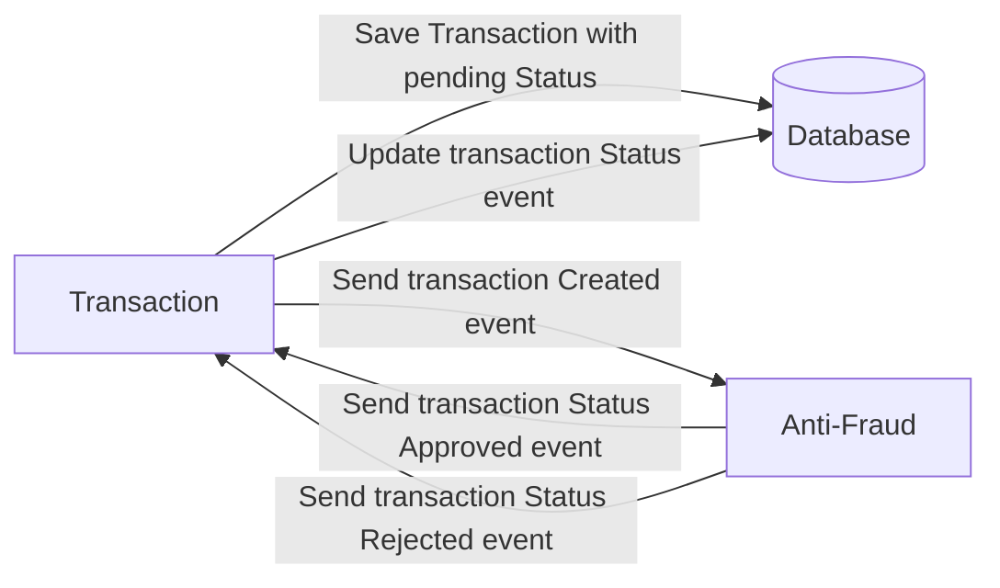

# Yape Code Challenge :rocket:

Our code challenge will let you marvel us with your Jedi coding skills :smile:. 

Don't forget that the proper way to submit your work is to fork the repo and create a PR :wink: ... have fun !!

- [Problem](#problem)
- [Tech Stack](#tech_stack)
- [Send us your challenge](#send_us_your_challenge)

# Problem

Every time a financial transaction is created it must be validated by our anti-fraud microservice and then the same service sends a message back to update the transaction status.
For now, we have only three transaction statuses:

<ol>
  <li>pending</li>
  <li>approved</li>
  <li>rejected</li>  
</ol>

Every transaction with a value greater than 1000 should be rejected.



# Tech Stack

<ol>
  <li>Node. You can use any framework you want (i.e. Nestjs with an ORM like TypeOrm or Prisma) </li>
  <li>Any database</li>
  <li>Kafka</li>    
</ol>

We do provide a `Dockerfile` to help you get started with a dev environment.

You must have two resources:

1. Resource to create a transaction that must containt:

```json
{
  "accountExternalIdDebit": "Guid",
  "accountExternalIdCredit": "Guid",
  "tranferTypeId": 1,
  "value": 120
}
```

2. Resource to retrieve a transaction

```json
{
  "transactionExternalId": "Guid",
  "transactionType": {
    "name": ""
  },
  "transactionStatus": {
    "name": ""
  },
  "value": 120,
  "createdAt": "Date"
}
```

## Optional

You can use any approach to store transaction data but you should consider that we may deal with high volume scenarios where we have a huge amount of writes and reads for the same data at the same time. How would you tackle this requirement?

You can use Graphql;

# Send us your challenge

When you finish your challenge, after forking a repository, you **must** open a pull request to our repository. There are no limitations to the implementation, you can follow the programming paradigm, modularization, and style that you feel is the most appropriate solution.

If you have any questions, please let us know.

# Solution
For this scenario I created two reactive microservices transaction-service and anti-fraud-service , two Apache Kafka Topics (transactions, fraud-results) to communicate each other and Neo4J graph db to store transactions.

## Stack
- Java 25
- Maven 3.5.10
- Zookeeper
- Apache Kafka
- Neo4J

## Instructions to run the solution
You just run the following docker command line, it download and create images and then run docker instances for zookeeper, apache kafka, neo4j, transaction-service, anti-fraud-service.

```sh
docker-compose up -d
```

## Functionality
### 1. Call transaction endpoint creation
To test the flow we can call the following endpoint in order to create the transaction, you can call multiple times with differen values minor or major than 1000, this endpoint register the transaction in the neo4j database and sent the evento to the transaction topic.

```curl
curl --location 'http://localhost:8080/api/v1/transactions' \
--header 'Content-Type: application/json' \
--data '{
    "accountExternalIdDebit":"ACCT_DEBT_999_1",
    "accountExternalIdCredit":"ACCT_CRED_999_1",
    "transferTypeId":1,
    "value": 1100
}'
```


### 2. Fraud evaluation
- The anti-fraud-service listen the events from the transaction topic.
- Evaluate the amount
- Send the new status (ACCEPTED, REJECTED) to the fraud-results topic
- The transaction-service listen the events and update the status.

### 3. Verify creation and updating status
You have two ways to verify the transaction status: by endoint and by neo4j console
- By endpoint: you can use the following endpoint (replace the transactionId)
```curl
curl --location 'http://localhost:8080/api/v1/transactions/fb2e5b98-6414-421f-9eff-349806889d18'
```
- By neo4j console: you can go the following and run the query.
```url
http://localhost:7474/browser/
```

```sh
MATCH (n:Account) RETURN n LIMIT 25
```
