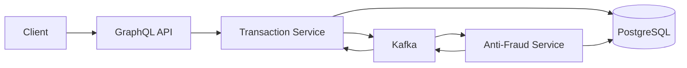
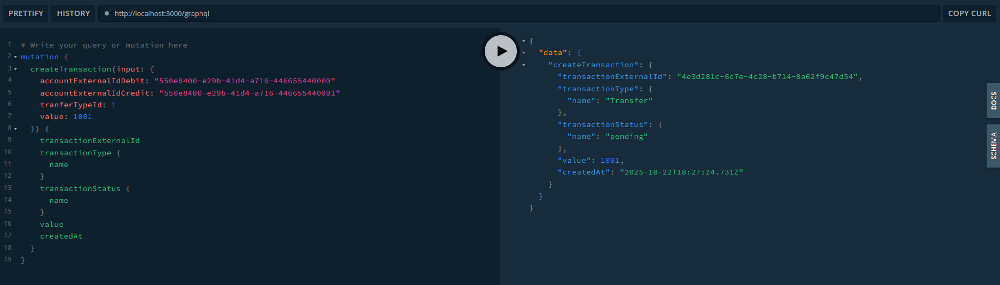
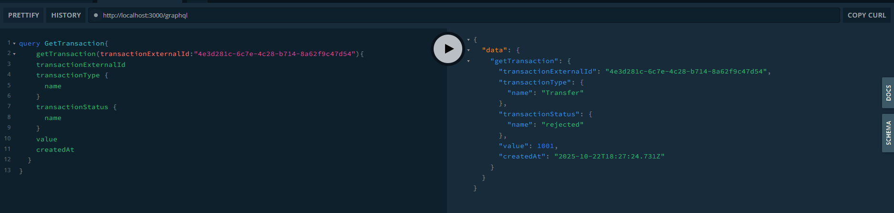
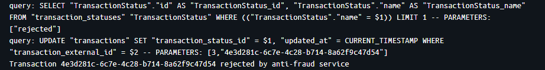
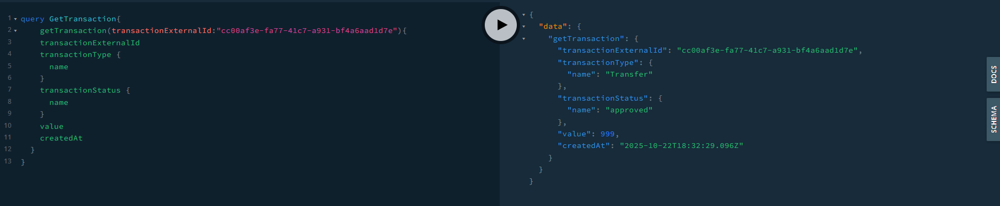
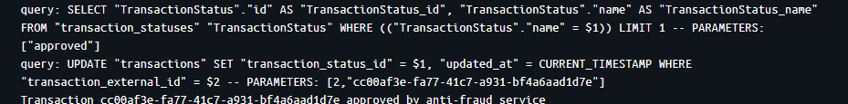

# Yape Code Challenge :rocket:

A complete implementation of the Yape Code Challenge using TypeScript, NestJS, GraphQL, PostgreSQL, and Kafka. This project demonstrates a microservices architecture for financial transaction processing with anti-fraud capabilities.

## 📋 Problem Statement

Every time a financial transaction is created, it must be validated by our anti-fraud microservice and then the same service sends a message back to update the transaction status. We have three transaction statuses:

1. **pending** - Initial status when transaction is created
2. **approved** - Transaction passes anti-fraud validation
3. **rejected** - Transaction fails anti-fraud validation

**Anti-Fraud Rule**: Every transaction with a value greater than 1000 should be rejected.

## 🏗️ Architecture

The application follows an event-driven microservices architecture:



### Key Components

- **Transaction Service**: Handles transaction creation and retrieval via GraphQL
- **Anti-Fraud Service**: Processes transactions and applies fraud detection rules
- **Kafka**: Message broker for event-driven communication
- **PostgreSQL**: Database for transaction persistence
- **GraphQL API**: Modern API with introspection and playground

## 🚀 Quick Start

### Prerequisites

- Node.js 20+
- Docker and Docker Compose
- npm or yarn

### Installation & Setup

1. **Clone and install dependencies:**
```bash
git clone https://github.com/jo3l17/app-nodejs-codechallenge/tree/main
cd app-nodejs-codechallenge
npm install
```

2. **Set up environment:**
```bash
cp .env.example .env
# Edit .env if needed (defaults should work)
```

3. **Start all services (including the application):**
```bash
npm run docker:up
```

4. **Wait for services to be ready (30 seconds), then seed the database:**
```bash
npm run build
npm run seed
```

**Note:** The application is already running! Docker automatically starts the app in development mode with hot reload. You only need to seed the database after the services are ready.

The application will be available at:
- **GraphQL Playground**: http://localhost:3000/graphql
- **Kafka UI**: http://localhost:8080

## 🧪 Testing

### Manual Testing via GraphQL Playground

#### 1. Create a Transaction

**GraphQL Mutation:**
```graphql
mutation {
  createTransaction(input: {
    accountExternalIdDebit: "550e8400-e29b-41d4-a716-446655440000"
    accountExternalIdCredit: "550e8400-e29b-41d4-a716-446655440001"
    tranferTypeId: 1
    value: 500
  }) {
    transactionExternalId
    transactionType {
      name
    }
    transactionStatus {
      name
    }
    value
    createdAt
  }
}
```

**Expected Response:**
```json
{
  "data": {
    "createTransaction": {
      "transactionExternalId": "generated-uuid",
      "transactionType": {
        "name": "Transfer"
      },
      "transactionStatus": {
        "name": "pending"
      },
      "value": 500,
      "createdAt": "2024-01-01T00:00:00.000Z"
    }
  }
}
```

#### 2. Retrieve a Transaction

**GraphQL Query:**
```graphql
query {
  getTransaction(transactionExternalId: "your-transaction-id") {
    transactionExternalId
    transactionType {
      name
    }
    transactionStatus {
      name
    }
    value
    createdAt
  }
}
```

### Automated Testing

```bash
# Run all tests
npm test

# Run tests in watch mode
npm run test:watch

# Run tests with coverage
npm run test:coverage

# Run API integration tests
npm run test:api

# Test Kafka messaging
npm run test:kafka
```

## 📸 Examples

### Rejected Transaction

#### Create Transaction


#### Get Transaction


#### Process by Anti-Fraud


### Approved Transaction

#### Create Transaction


#### Get Transaction


#### Process by Anti-Fraud



## 🔄 Transaction Processing Flow

### Step-by-Step Process

1. **Transaction Creation**
   - Client sends GraphQL mutation to create a transaction
   - Transaction Service validates input and saves transaction with `pending` status
   - `transaction.created` event is published to Kafka

2. **Anti-Fraud Processing**
   - Anti-Fraud service consumes `transaction.created` event
   - Applies business rule: transactions > 1000 are rejected
   - Updates transaction status in database
   - Publishes `transaction.status` event

3. **Status Update**
   - Transaction service receives status update
   - Transaction is now in final state (`approved` or `rejected`)

### Kafka Topics

- **`transaction.created`**: Published when a new transaction is created
- **`transaction.status`**: Published when transaction status is updated

## 🔧 Development Commands

```bash
# Development
npm run dev              # Start in development mode
npm run build           # Build the application
npm start               # Start production build

# Code Quality
npm run lint            # Run ESLint
npm run lint:fix        # Fix ESLint issues
npm run format          # Format code with Prettier
npm run format:check    # Check code formatting

# Database
npm run seed            # Seed database with initial data
npm run migration:generate  # Generate migration
npm run migration:run       # Run migrations
npm run migration:revert     # Revert last migration

# Docker
npm run docker:up       # Start all services
npm run docker:down     # Stop all services
npm run docker:logs     # View service logs
npm run docker:build    # Build Docker images

# Production Docker
npm run docker:prod     # Start production environment
npm run docker:prod:build  # Build production images
npm run docker:prod:down   # Stop production environment
npm run docker:prod:logs  # View production logs
```

## 📊 Monitoring & Debugging

### Kafka UI
- **URL**: http://localhost:8080
- **Features**: View topics, messages, consumer groups, and partitions
- **Usage**: Monitor message flow and troubleshoot issues

### Application Logs
```bash
# View all service logs
npm run docker:logs

# View specific service logs
docker-compose logs -f app
docker-compose logs -f kafka
```

## 🎯 Key Features

### ✅ Requirements Met

1. **Transaction Creation**: GraphQL mutation with proper validation
2. **Transaction Retrieval**: GraphQL query by external ID
3. **Anti-Fraud Logic**: Rejects transactions > 1000
4. **Event-Driven Architecture**: Kafka for async communication
5. **Database Persistence**: PostgreSQL with TypeORM
6. **TypeScript**: Full type safety
7. **GraphQL**: Modern API with introspection

### 🚀 Additional Features

- **Comprehensive Testing**: Unit tests with Jest
- **Code Quality**: ESLint + Prettier
- **Docker Support**: Complete development environment
- **Database Seeding**: Automated setup
- **Monitoring**: Kafka UI for debugging
- **Error Handling**: Proper exception handling
- **Validation**: Input validation with class-validator
- **Production Ready**: Docker production configuration

## 🔍 Anti-Fraud Logic

The anti-fraud service implements the business rule:
- **Transactions ≤ 1000**: Status = "approved"
- **Transactions > 1000**: Status = "rejected"

This is processed asynchronously via Kafka events, ensuring the API remains responsive.

## 🐛 Troubleshooting

### Common Issues

1. **Database Connection Issues**
   - Ensure PostgreSQL is running: `docker ps`
   - Check connection string in `.env`

2. **Kafka Connection Issues**
   - Ensure Kafka is running: `docker ps`
   - Check Kafka UI at http://localhost:8080

3. **Transaction Status Not Updating**
   - Check application logs for Kafka messages
   - Verify anti-fraud service is running
   - Check Kafka topics in Kafka UI

### Debug Commands

```bash
# Check Docker services
docker ps

# View application logs
npm run docker:logs

# Test Kafka connection
npm run test:kafka
```

---

## 🎉 Ready to Use!

The application is fully functional and ready for testing. All requirements from the challenge have been implemented.

**Next Steps:**
1. Run the setup commands above
2. Test the GraphQL endpoints
3. Verify anti-fraud processing
4. Explore the Kafka UI for message flow
5. Run the automated tests
