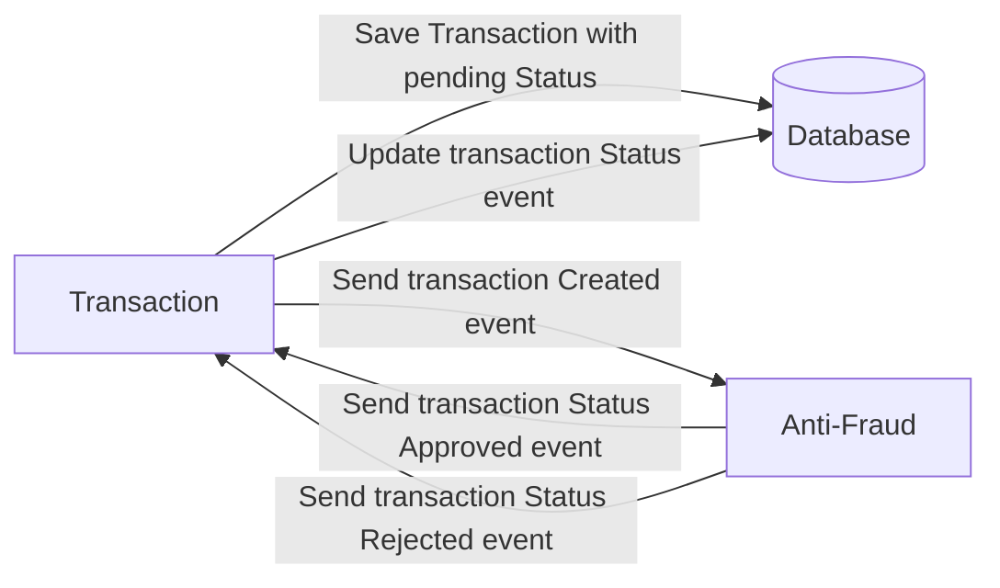

# Yape Code Challenge :rocket:

Our code challenge will let you marvel us with your Jedi coding skills :smile:.

Don't forget that the proper way to submit your work is to fork the repo and create a PR :wink: ... have fun !!

- [Problem](#problem)
- [Tech Stack](#tech_stack)
- [Send us your challenge](#send_us_your_challenge)

---

# Problem

Every time a financial transaction is created it must be validated by our anti-fraud microservice and then the same service sends a message back to update the transaction status.
For now, we have only three transaction statuses:

<ol>
  <li>pending</li>
  <li>approved</li>
  <li>rejected</li>
</ol>

Every transaction with a value greater than 1000 should be rejected.



---

# Tech Stack

<ol>
  <li>Java 21 con Spring Boot 4.x + WebFlux (Reactivo)</li>
  <li>PostgreSQL 17 como base de datos</li>
  <li>Kafka para comunicación asíncrona entre microservicios</li>
  <li>Redis como capa de caché para alto volumen</li>
  <li>R2DBC para conexión reactiva a PostgreSQL</li>
</ol>

# Getting Started

### Prerrequisitos

- Docker y Docker Compose instalados
- Java 21 (solo para desarrollo local)
- Maven 3.9+ (solo para desarrollo local)

### Levanta todo con un solo comando

```bash
docker-compose up --build
```

Microservicios disponibles:

| Servicio             | URL / Puerto              |
|----------------------|---------------------------|
| Transaction API      | http://localhost:8080     |
| PostgreSQL           | localhost:5432            |
| Kafka                | localhost:9092            |
| Redis                | localhost:6379            |

---

# APIs Documentation

## Crear una transacción

```http
POST /v1/transactions
Content-Type: application/json
```
## Probar

```bash
curl --location 'http://localhost:8080/v1/transactions' \
--header 'Content-Type: application/json' \
--data '{
    "accountExternalIdDebit": "d62a2a4c-65ac-4c61-aacf-59ab55e7c970",
    "accountExternalIdCredit": "d62a2a4c-65ac-4c61-aacf-59ab55e7c971",
    "transferTypeId": 1,
    "value": 100.10
}'

**Response `201 Created`:**
```json
{
    "transactionAmount": 100.10,
    "transactionExternalId": "578fa71b-f0f1-490b-8a1c-0645fadd2ba4",
    "transactionId": "498329fd-ee36-4525-8b71-f09e56b74a8b"
}
```

---

## Consultar una transacción

```http
GET /v1/transactions/{transactionExternalId}
```
curl --location 'http://localhost:8080/v1/transactions/578fa71b-f0f1-490b-8a1c-0645fadd2ba4'

**Response `200 OK`:**
```json
{
    "transactionExternalId": "578fa71b-f0f1-490b-8a1c-0645fadd2ba4",
    "transactionType": {
        "name": "Debit"
    },
    "transactionStatus": {
        "name": "Approved"
    },
    "value": 100.10,
    "createdAt": "2026-02-21 16:38:46"
}
```

---

# Kafka Events

| Topic                          | Productor             | Consumidor            |
|--------------------------------|-----------------------|-----------------------|
| `transaction.created`          | Transaction Service   | Anti-Fraud Service    |
| `transaction.status.updated`   | Anti-Fraud Service    | Transaction Service   |

### `transaction.created`
```json
{
  "transactionExternalId": "578fa71b-f0f1-490b-8a1c-0645fadd2ba4",
  "value": 120
}
```

### `transaction.status.updated`
```json
{
  "transactionExternalId": "578fa71b-f0f1-490b-8a1c-0645fadd2ba4",
  "status": "Approved"
}
```

---

# Optional Solution

Para manejar alto volumen de lecturas y escrituras simultáneas se implementó una estrategia de **Cache-Aside con Redis**:

### ¿Cómo funciona?

Cuando crea la transacción, en simultane ejecuta el evento para kafka y guarda los datos de la transaccion en cache, cuando alguien quiere consultar el endoint del detalle de la transaccion, irá primero a cache y ya no a la base de datos, si no existe, irá a la base de datos. Esto en un escensario de alto volumen, beneficia en cuanto tiempos de respuesta. Una vez que el microservicio antifraude, valida la regla para aprobar o rechazar, envia al topico para que el microservicio de transaction actualice el estado y ademas refresca el cache con el estado tambien.
---

# Send us your challenge

When you finish your challenge, after forking a repository, you **must** open a pull request to our repository. There are no limitations to the implementation, you can follow the programming paradigm, modularization, and style that you feel is the most appropriate solution.

If you have any questions, please let us know.
