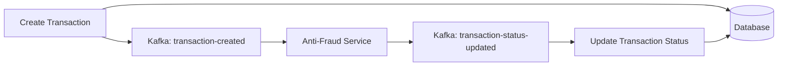

# Yape Code Challenge - Servicio de Transacciones Financieras

Servicio de Transacciones Financieras con Integración Anti-Fraude construido con principios de **Arquitectura Limpia**, siguiendo las mejores prácticas de la industria para escalabilidad, mantenibilidad y observabilidad.

## Tabla de Contenidos

1. [Resumen](#resumen)
2. [Arquitectura](#arquitectura)
3. [Stack Tecnológico](#stack-tecnológico)
4. [Características](#características)
5. [Inicio Rápido](#inicio-rápido)
6. [Documentación de la API](#documentación-de-la-api)
7. [Pruebas](#pruebas)
8. [Reglas de Negocio](#reglas-de-negocio)
9. [Monitoreo y Observabilidad](#monitoreo-y-observabilidad)

## Resumen

Este sistema gestiona transacciones financieras con validación anti-fraude en tiempo real a través de mensajería Kafka. Cada transacción comienza como `pending`, es validada por el servicio anti-fraude, y se actualiza a estado `approved` o `rejected`.

### Diagrama de Flujo


## Arquitectura

Construido siguiendo principios de **Arquitectura Hexagonal (Arquitectura Limpia)**:

```
src/
├── domain/           # Business Logic (Entities, Use Cases, Ports)
├── application/      # Application Services (Handlers, DTOs, Mappers)
└── infrastructure/   # External Concerns (Controllers, Adapters, Config)
```

### Principios Clave Aplicados:
- **Principios SOLID**
- **Diseño Dirigido por Dominio (DDD)**
- **Patrón Puertos y Adaptadores**
- **Inversión de Dependencias**
- **Código Limpio**

## Stack Tecnológico

- **Framework**: Node.js + NestJS (TypeScript)
- **Base de Datos**: PostgreSQL + TypeORM
- **Mensajería**: Kafka
- **Documentación**: Swagger/OpenAPI
- **Validación**: class-validator
- **Logging**: Winston (logging estructurado)
- **Pruebas**: Jest
- **Arquitectura**: Hexagonal/Arquitectura Limpia

## Características

### Características Principales
- Crear transacciones financieras
- Recuperar detalles de transacciones
- Validación anti-fraude en tiempo real
- Actualizaciones automáticas de estado (pending → approved/rejected)

### Características de Calidad
- **Logging Estructurado** con IDs de correlación
- **Manejo Global de Excepciones**
- **Validación de Entrada** con mensajes de error detallados
- **Documentación de API** con Swagger
- **Endpoint de Health Check**
- **Soporte CORS**
- **Implementación de Arquitectura Limpia**

## Inicio Rápido

### Prerrequisitos
- Node.js 18+ 
- Docker & Docker Compose
- Git

### 1. Clonar y Configurar
```bash
git clone <repository-url>
cd app-nodejs-codechallenge
```

### 2. Configuración del Entorno
```bash
# Copiar plantilla de variables de entorno
cp .env.example .env

# Instalar dependencias
npm install

# Instalar dependencias del Simulador Anti-Fraude
cd anti-fraud-simulator
npm install
cd ..
```

### 3. Iniciar Infraestructura
```bash
# Iniciar PostgreSQL y Kafka
npm run docker:up
```

### 4. Inicializar Base de Datos
```bash
# Conectar a PostgreSQL y ejecutar script de inicialización
docker exec -i <postgres-container-id> psql -U postgres < database/init.sql
```

### 5. Iniciar Servicios
```bash
# Terminal 1: Iniciar aplicación principal
npm run start:dev

# Terminal 2: Iniciar simulador anti-fraude
cd anti-fraud-simulator
npm start
```

### 6. Verificar Configuración
- **API**: http://localhost:3000/api/v1/health
- **Documentación Swagger**: http://localhost:3000/api/docs
- **Logs de la Aplicación**: Revisar consola para logs estructurados

## Documentación de la API

### URL Base
```
http://localhost:3000/api/v1
```

### Endpoints

#### Crear Transacción
```http
POST /transactions
Content-Type: application/json

{
  "accountExternalIdDebit": "123e4567-e89b-12d3-a456-426614174000",
  "accountExternalIdCredit": "123e4567-e89b-12d3-a456-426614174001", 
  "tranferTypeId": 1,
  "value": 120
}
```

#### Obtener Transacción
```http
GET /transactions/{transactionExternalId}
```

#### Health Check
```http
GET /health
```

### Documentación Completa de la API
Visitar: http://localhost:3000/api/docs

## Pruebas

```bash
# Ejecutar todas las pruebas
npm test

# Ejecutar pruebas con cobertura
npm run test:cov

# Ejecutar pruebas en modo watch
npm run test:watch
```

## Reglas de Negocio

1. **Creación de Transacciones**: Todas las transacciones inician con estado `pending`
2. **Validación Anti-Fraude**: Transacciones > 1000 son automáticamente rechazadas
3. **Actualizaciones de Estado**: Procesamiento asíncrono vía mensajería Kafka
4. **Validación de Datos**: Validación estricta de entrada con respuestas de error detalladas

## Monitoreo y Observabilidad

### Logging Estructurado
- **ID de Correlación**: Rastrea solicitudes a través de servicios
- **Formato JSON**: Logs legibles por máquina
- **Múltiples Niveles**: Error, Warn, Info, Debug

### Monitoreo de Salud
- **Endpoint de Salud**: `/api/v1/health`
- **Salud de Base de Datos**: Monitoreo de conexión
- **Salud de Kafka**: Estado del broker de mensajes

### Manejo de Errores
- **Filtro Global de Excepciones**: Manejo centralizado de errores
- **Formato de Error Consistente**: Siguiendo el patrón del proyecto de referencia
```json
{
  "mensaje": "Descripción del error"
}
```

## Ejemplos de Uso

### Crear una transacción pequeña (será aprobada)
```bash
curl -X POST http://localhost:3000/api/v1/transactions \
  -H "Content-Type: application/json" \
  -d '{
    "accountExternalIdDebit": "acc-001",
    "accountExternalIdCredit": "acc-002",
    "tranferTypeId": 1,
    "value": 500
  }'
```

### Crear una transacción grande (será rechazada)
```bash
curl -X POST http://localhost:3000/api/v1/transactions \
  -H "Content-Type: application/json" \
  -d '{
    "accountExternalIdDebit": "acc-003",
    "accountExternalIdCredit": "acc-004", 
    "tranferTypeId": 1,
    "value": 1500
  }'
```

### Verificar estado de transacción
```bash
curl http://localhost:3000/api/v1/transactions/{transactionExternalId}
```

## Configuración

Variables de entorno clave:

```env
# Aplicación
NODE_ENV=development
PORT=3000

# Base de Datos  
DB_HOST=localhost
DB_PORT=5432
DB_USERNAME=postgres
DB_PASSWORD=postgres
DB_NAME=yape_challenge

# Kafka
KAFKA_BROKER=localhost:9092
ANTI_FRAUD_TOPIC=transaction-created
TRANSACTION_STATUS_TOPIC=transaction-status-updated
```

## Mejores Prácticas Implementadas

Esta implementación incluye:

- **Arquitectura Limpia** con clara separación de responsabilidades
- **Principios SOLID** a lo largo del código base  
- **Inyección de Dependencias** con abstracción apropiada
- **Logging Estructurado** con seguimiento de correlación
- **Manejo Global de Excepciones** con formato de error consistente
- **Validación de Entrada** con mensajes de error detallados
- **Documentación de API** con documentos Swagger comprensivos
- **Monitoreo de Salud** para observabilidad
- **Mensajería Asíncrona** con integración Kafka
- **Diseño de Base de Datos** con indexación y restricciones apropiadas

## Notas

- El sistema usa **PostgreSQL** para persistencia con propiedades ACID apropiadas
- **Kafka** asegura entrega confiable de mensajes entre servicios
- **TypeORM** proporciona abstracción de base de datos con migraciones automáticas
- **Reglas anti-fraude** están centralizadas en el servicio dedicado
- **Logging** incluye IDs de correlación para rastreo distribuido
- **Manejo de errores** sigue el patrón establecido del proyecto de referencia

---

**Construido siguiendo principios de Arquitectura Limpia y mejores prácticas de la industria**
