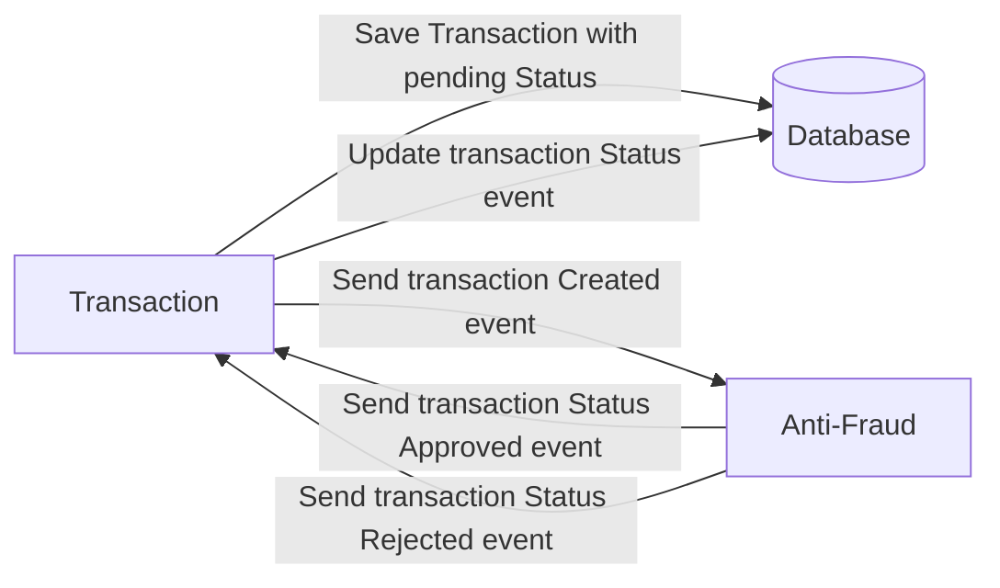

# Yape Code Challenge :rocket:

Our code challenge will let you marvel us with your Jedi coding skills :smile:.

Don't forget that the proper way to submit your work is to fork the repo and create a PR :wink: ... have fun !!

- [Problem](#problem)
- [Solution Architecture](#solution-architecture)
- [Tech Stack](#tech_stack)
- [Getting Started](#getting-started)
- [API Usage](#api-usage)
- [Testing](#testing)
- [Send us your challenge](#send_us_your_challenge)

# Problem

Every time a financial transaction is created it must be validated by our anti-fraud microservice and then the same service sends a message back to update the transaction status.
For now, we have only three transaction statuses:

<ol>
  <li>pending</li>
  <li>approved</li>
  <li>rejected</li>  
</ol>

Every transaction with a value greater than 1000 should be rejected.



# Solution Architecture

This solution implements a **microservices architecture** with event-driven communication using Kafka. The system is designed to handle high-volume transaction processing with built-in idempotency and concurrent transaction safety.

## Architecture Overview

The application consists of two independent microservices:

### 1. **Transaction Service** (`src/transactions`)
- **GraphQL API** for transaction management
- **PostgreSQL database** for persistent storage with Prisma ORM
- **Kafka producer** to publish transaction creation events
- **Kafka consumer** to receive and process status updates from antifraud
- **Advisory locks** to ensure transaction idempotency and prevent race conditions

### 2. **Anti-Fraud Service** (`src/antifraud`)
- **Kafka consumer** to receive transaction creation events
- **Business logic** to evaluate transactions (rejects transactions > 1000)
- **Kafka producer** to publish transaction status events (approved/rejected)
- Stateless service - no database required

## Key Features

### High-Volume Transaction Handling
- **Idempotency**: Uses hash-based idempotency keys to prevent duplicate transactions
- **PostgreSQL Advisory Locks**: Prevents race conditions during concurrent transaction creation
- **Kafka for Async Processing**: Decouples services for better scalability
- **Connection Pooling**: Efficient database connection management

### Event-Driven Communication
```
Client → Transaction Service (GraphQL)
   ↓
[Save to DB with "pending" status]
   ↓
[Publish to Kafka: transaction.created]
   ↓
Anti-Fraud Service (Consumer)
   ↓
[Evaluate transaction rules]
   ↓
[Publish to Kafka: transaction.status]
   ↓
Transaction Service (Consumer)
   ↓
[Update transaction status in DB]
```

## Project Structure

```
├── src/
│   ├── transactions/          # Transaction microservice
│   │   ├── graphql/           # GraphQL schema and resolvers
│   │   ├── modules/
│   │   │   └── transactions/  # Transaction domain logic
│   │   ├── messaging/         # Kafka integration
│   │   ├── locks/             # PostgreSQL advisory locks
│   │   ├── db/                # Prisma client
│   │   ├── http/              # Apollo Server setup
│   │   └── main.ts            # Service entry point
│   │
│   └── antifraud/             # Anti-fraud microservice
│       ├── modules/
│       │   └── antifraud/     # Anti-fraud domain logic
│       ├── messaging/         # Kafka integration
│       └── main.ts            # Service entry point
│
└── docker-compose.yml         # Infrastructure (PostgreSQL + Kafka)
```

# Tech Stack

### Transaction Service
- **Node.js** with TypeScript
- **Apollo Server** (GraphQL)
- **PostgreSQL** (Database)
- **Prisma** (ORM)
- **KafkaJS** (Message broker client)
- **Pino** (Logging)
- **Zod** (Validation)

### Anti-Fraud Service
- **Node.js** with TypeScript
- **KafkaJS** (Message broker client)
- **Pino** (Logging)
- **Zod** (Validation)

### Infrastructure
- **Apache Kafka** (Message broker)
- **PostgreSQL** (Database)
- **Docker & Docker Compose** (Containerization)

### Testing
- **Jest** (Test framework)
- **Testcontainers** (Integration testing with Docker)

# Getting Started

## Prerequisites
- Docker and Docker Compose
- Node.js 20+ and pnpm

## Installation

1. **Clone the repository**
```bash
git clone <repository-url>
cd app-nodejs-codechallenge
```

2. **Start infrastructure services** (PostgreSQL + Kafka)
```bash
docker-compose up -d
```

3. **Install dependencies and setup databases**

For Transaction Service:
```bash
cd src/transactions
pnpm install
pnpm prisma generate
pnpm prisma migrate deploy
pnpm prisma:seed  # Seeds initial transaction types and statuses
```

For Anti-Fraud Service:
```bash
cd src/antifraud
pnpm install
```

4. **Start the services**

In separate terminals:

Transaction Service:
```bash
cd src/transactions
pnpm dev  # Runs on http://localhost:3000
```

Anti-Fraud Service:
```bash
cd src/antifraud
pnpm dev
```

5. **Access GraphQL Playground**

Open your browser at `http://localhost:3000/graphql`

# API Usage

The Transaction Service exposes a GraphQL API with the following operations:

## Create Transaction

**Mutation:**
```graphql
mutation CreateTransaction($input: CreateTransactionInput!) {
  createTransaction(input: $input) {
    transactionExternalId
    transactionType {
      name
    }
    transactionStatus {
      name
    }
    value
    createdAt
  }
}
```

**Variables:**
```json
{
  "input": {
    "accountExternalIdDebit": "d0424ef9-7f7b-4f6e-9c8d-2c3f4e5a6b7c",
    "accountExternalIdCredit": "a1b2c3d4-e5f6-7890-abcd-ef1234567890",
    "transferTypeId": 1,
    "value": 150.00
  }
}
```

**Response:**
```json
{
  "data": {
    "createTransaction": {
      "transactionExternalId": "550e8400-e29b-41d4-a716-446655440000",
      "transactionType": {
        "name": "internal"
      },
      "transactionStatus": {
        "name": "pending"
      },
      "value": 150.00,
      "createdAt": "2025-01-15T10:30:00.000Z"
    }
  }
}
```

## Get Transaction by ID

**Query:**
```graphql
query GetTransaction($transactionExternalId: String!) {
  transaction(transactionExternalId: $transactionExternalId) {
    transactionExternalId
    transactionType {
      name
    }
    transactionStatus {
      name
    }
    value
    createdAt
  }
}
```

**Variables:**
```json
{
  "transactionExternalId": "550e8400-e29b-41d4-a716-446655440000"
}
```

## List All Transactions

**Query:**
```graphql
query GetAllTransactions {
  transactions {
    transactionExternalId
    transactionType {
      name
    }
    transactionStatus {
      name
    }
    value
    createdAt
  }
}
```

## Transaction Types

- **1**: Internal transfer
- **2**: External transfer

## Transaction Statuses

- **pending**: Initial status when transaction is created
- **approved**: Transaction passed anti-fraud validation (value ≤ 1000)
- **rejected**: Transaction failed anti-fraud validation (value > 1000)

## Example cURL Requests

**Create a transaction (will be approved):**
```bash
curl -X POST http://localhost:3000/graphql \
  -H "Content-Type: application/json" \
  -d '{
    "query": "mutation CreateTransaction($input: CreateTransactionInput!) { createTransaction(input: $input) { transactionExternalId transactionStatus { name } value } }",
    "variables": {
      "input": {
        "accountExternalIdDebit": "d0424ef9-7f7b-4f6e-9c8d-2c3f4e5a6b7c",
        "accountExternalIdCredit": "a1b2c3d4-e5f6-7890-abcd-ef1234567890",
        "transferTypeId": 1,
        "value": 500.00
      }
    }
  }'
```

**Create a transaction (will be rejected):**
```bash
curl -X POST http://localhost:3000/graphql \
  -H "Content-Type: application/json" \
  -d '{
    "query": "mutation CreateTransaction($input: CreateTransactionInput!) { createTransaction(input: $input) { transactionExternalId transactionStatus { name } value } }",
    "variables": {
      "input": {
        "accountExternalIdDebit": "d0424ef9-7f7b-4f6e-9c8d-2c3f4e5a6b7c",
        "accountExternalIdCredit": "a1b2c3d4-e5f6-7890-abcd-ef1234567890",
        "transferTypeId": 1,
        "value": 5000.00
      }
    }
  }'
```

**Get transaction:**
```bash
curl -X POST http://localhost:3000/graphql \
  -H "Content-Type: application/json" \
  -d '{
    "query": "query GetTransaction($transactionExternalId: String!) { transaction(transactionExternalId: $transactionExternalId) { transactionExternalId transactionStatus { name } value } }",
    "variables": {
      "transactionExternalId": "550e8400-e29b-41d4-a716-446655440000"
    }
  }'
```

# Testing

The project includes comprehensive unit and integration tests.

## Run All Tests

**Transaction Service:**
```bash
cd src/transactions
pnpm test              # All tests
pnpm test:unit         # Unit tests only
pnpm test:integration  # Integration tests only
```

**Anti-Fraud Service:**
```bash
cd src/antifraud
pnpm test              # All tests
pnpm test:unit         # Unit tests only
pnpm test:integration  # Integration tests only
```

## Test Coverage

- **Transaction Service**: 16 tests (9 unit + 7 integration)
- **Anti-Fraud Service**: 13 tests (10 unit + 3 integration)
- **Total**: 29 tests covering all critical paths

Integration tests use Testcontainers to spin up real PostgreSQL and Kafka instances, ensuring tests run against actual infrastructure.

# Send us your challenge

When you finish your challenge, after forking a repository, you **must** open a pull request to our repository. There are no limitations to the implementation, you can follow the programming paradigm, modularization, and style that you feel is the most appropriate solution.

If you have any questions, please let us know.
