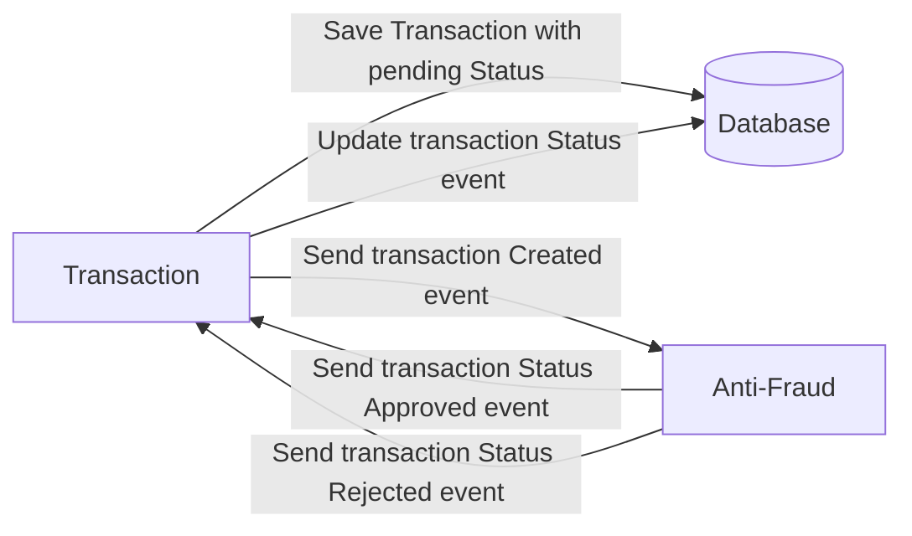

# Yape Code Challenge :rocket:

Our code challenge will let you marvel us with your Jedi coding skills :smile:. 

Don't forget that the proper way to submit your work is to fork the repo and create a PR :wink: ... have fun !!

- [Problem](#problem)
- [Tech Stack](#tech_stack)
- [Implementation](#implementation)
- [Quick Start](#quick_start)
- [Send us your challenge](#send_us_your_challenge)

# Problem

Every time a financial transaction is created it must be validated by our anti-fraud microservice and then the same service sends a message back to update the transaction status.
For now, we have only three transaction statuses:

<ol>
  <li>pending</li>
  <li>approved</li>
  <li>rejected</li>  
</ol>

Every transaction with a value greater than 1000 should be rejected.



# Tech Stack

<ol>
  <li>Node. You can use any framework you want (i.e. Nestjs with an ORM like TypeOrm or Prisma) </li>
  <li>Any database</li>
  <li>Kafka</li>    
</ol>

We do provide a `Dockerfile` to help you get started with a dev environment.

You must have two resources:

1. Resource to create a transaction that must containt:

```json
{
  "accountExternalIdDebit": "Guid",
  "accountExternalIdCredit": "Guid",
  "tranferTypeId": 1,
  "value": 120
}
```

2. Resource to retrieve a transaction

```json
{
  "transactionExternalId": "Guid",
  "transactionType": {
    "name": ""
  },
  "transactionStatus": {
    "name": ""
  },
  "value": 120,
  "createdAt": "Date"
}
```

# Implementation

This solution implements two microservices with the following key features:

### 🏗️ **Architecture Overview**
- **Transaction Service** (Port 3001) - HTTP REST API + Kafka microservice
- **Fraud Detection Service** (Port 3002) - HTTP service + Kafka microservice
- **Outbox Pattern** - Ensures reliable event publishing
- **NestJS Microservices** - Kafka transport with event patterns

### 🔧 **Technologies Used**
- **NestJS** - Node.js framework with TypeScript
- **TypeORM** - Database ORM for PostgreSQL
- **PostgreSQL** - Primary database 
- **Kafka** - Message broker for events
- **Docker & Docker Compose** - Containerization
- **pnpm** - Fast package manager

### 🔄 **Event Flow Implementation**
1. **Transaction Creation** → Saves to DB with "pending" status
2. **Outbox Pattern** → Event stored in same transaction 
3. **Background Processor** → Publishes events to Kafka every 5 seconds
4. **Fraud Detection** → `@EventPattern('transaction.created')` consumes events
5. **Status Update** → Emits `transaction.status.updated` pattern
6. **Transaction Update** → `@EventPattern('transaction.status.updated')` updates DB

### **Quick Start**

```bash
docker compose up -d
```

### **API Examples**

**Create Transaction:**
```bash
POST http://localhost:3001/transactions
{
  "accountExternalIdDebit": "550e8400-e29b-41d4-a716-446655440000",
  "accountExternalIdCredit": "550e8400-e29b-41d4-a716-446655440001",
  "tranferTypeId": 1,
  "value": 500
}
```

**Get Transaction:**
```bash
GET http://localhost:3001/transactions/{transactionId}
```

### **Testing Scenarios**
- Valid transaction (≤$1000) → Gets approved
- Fraudulent transaction (>$1000) → Gets rejected
- Real-time status updates via Kafka events
- Outbox pattern ensures no events are lost


## Optional

You can use any approach to store transaction data but you should consider that we may deal with high volume scenarios where we have a huge amount of writes and reads for the same data at the same time. How would you tackle this requirement?

**High Volume Architecture Considerations:**

1. **Database Optimization:**
   - Read replicas for query scaling
   - Database sharding by account ID
   - Connection pooling & prepared statements
   - Proper indexing strategy

2. **Caching Layer:**
   - Redis for frequently accessed transactions
   - Application-level caching for reference data
   - CDN for static content

3. **Event Streaming:**
   - Kafka partitioning by account ID
   - Multiple consumer groups for parallel processing
   - Event sourcing for audit trails

4. **Microservices Scaling:**
   - Horizontal scaling with load balancers
   - Circuit breakers for fault tolerance
   - Async processing with queues


# Send us your challenge

When you finish your challenge, after forking a repository, you **must** open a pull request to our repository. There are no limitations to the implementation, you can follow the programming paradigm, modularization, and style that you feel is the most appropriate solution.

If you have any questions, please let us know.
