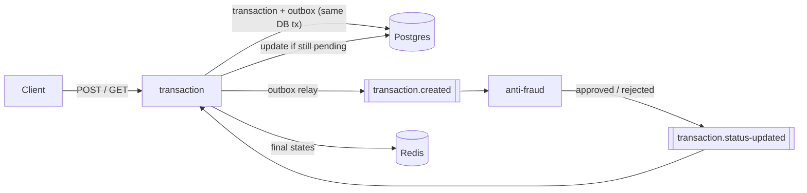

# Yape Code Challenge - solution

Two NestJS services that only talk to each other through Kafka:

- `transaction`: exposes the API, saves every transaction as `pending` and updates it when anti-fraud answers.
- `anti-fraud`: reads new transactions and rejects anything with a value greater than 1000.

## How to run it

```bash
docker compose up -d --build
```

Give it about a minute (Kafka is the slow one). The API is at `http://localhost:3000` and Swagger at `http://localhost:3000/docs`.

I kept the compose file you provided and added Redis, the two services and a small `kafka-init` container that creates the topics. Migrations run when the transaction service starts, so there's nothing else to set up.

## Trying it out

```bash
curl -X POST localhost:3000/transactions -H 'content-type: application/json' -d '{
  "accountExternalIdDebit": "11111111-1111-4111-8111-111111111111",
  "accountExternalIdCredit": "22222222-2222-4222-8222-222222222222",
  "tranferTypeId": 1,
  "value": 120
}'
```

You get a 201 with the transaction in `pending`. Do a GET with the `transactionExternalId` and it should already be `approved`:

```bash
curl localhost:3000/transactions/<transactionExternalId>
```

Some cases worth trying:

- `value: 1000` is approved (the rule says *greater than* 1000), `1000.01` is rejected.
- Missing or extra fields, invalid UUIDs, more than 2 decimals or the same account on both sides return 400.
- An unknown id returns 404.

## Architecture



A transaction only moves once: from `pending` to `approved` or `rejected`, and it stays there. Both topics have 3 partitions and use the `transactionExternalId` as the key, so every event for one transaction lands in the same partition, in order. Each topic also has a `.dlq` for messages that can't be processed.

## About the API contract

I kept the request and response exactly as they are in the challenge, including `tranferTypeId` (without the "s"). I didn't want to break anyone who tests against the original contract.

The challenge doesn't say what the transfer types are, so I seeded three: `1` Own accounts, `2` Third party, `3` Interbank.

I also added an optional `Idempotency-Key` header. If a client retries a POST with the same key, it gets the same transaction back instead of creating a second one. Using the same key with a different body returns 422.

## Design decisions

**Outbox instead of publishing directly.** Saving to Postgres and publishing to Kafka can't happen in one transaction. If the service dies between the two, you end up with a transaction stuck in `pending` forever. So the event is written to an `outbox` table in the same DB transaction, and a relay publishes it to Kafka. The relay uses `FOR UPDATE SKIP LOCKED`, so running more than one instance is safe.

**Duplicates are expected.** With the outbox and Kafka, a message can arrive more than once. The status update is `UPDATE ... WHERE status = 'pending'`, so a duplicate or late event simply doesn't match any row. A transaction that was already approved can't be flipped to rejected.

**No floats for money.** The value is stored as `numeric(18,2)`, travels in the event as a string (`"120.00"`), and anti-fraud compares it in cents using `BigInt`.

**DLQ only for bad messages.** A message that can't be parsed goes straight to the DLQ, so it doesn't block the partition. But if the database is down, sending valid messages to the DLQ would be wrong, so in that case the consumer keeps retrying with backoff until it comes back.

**Monorepo.** Both services live in one NestJS monorepo so they're easy to review and run. They only share the event contracts (`libs/contracts`) and the Kafka helpers (`libs/messaging`). Anti-fraud doesn't touch the database at all.

## High volume

> *"...we may deal with high volume scenarios where we have a huge amount of writes and reads for the same data at the same time. How would you tackle this requirement?"*

How I see it:

- **Writes:** the POST is just one short DB transaction. It doesn't wait for Kafka, because the relay publishes in the background, in batches. If the consumers fall behind, you can run more instances, up to one per partition.
- **Reads:** once a transaction is approved or rejected it never changes again, which makes it perfect for caching. The consumer writes the final state to Redis right after updating the DB, so the GET usually doesn't hit Postgres. If Redis goes down, the GET just reads from the DB.
- **Reads and writes on the same data:** each row is written exactly once after it's created, with a conditional update and no locks in the code. Postgres readers don't block writers, and most reads go to Redis anyway. I never cache `pending`, so you can't get an outdated status from the cache.

I ran a load test with k6, the reads target 20 ids over and over to simulate many reads on the same data:

| Load | Total | Errors | POST p95 | GET p95 | Time to approved/rejected (p95) |
|---|---|---|---|---|---|
| 100 writes/s + 500 reads/s | ~600 req/s | 0% | 4.5 ms | 1.4 ms | 223 ms |
| 500 writes/s + 2000 reads/s | ~2,500 req/s | 0% | 39 ms | 15 ms | 1.1 s |

After both runs there were no transactions left in `pending` and both DLQs were empty. The first thing to slow down is the async part, not the API.

## Tests

```bash
npm test           # unit tests: fraud rule and payload validation
npm run test:e2e   # needs the stack running (docker compose up)
```

## Project structure

```
apps/transaction/   API, outbox relay, status consumer, Redis cache, migrations
apps/anti-fraud/    Kafka consumer + the fraud rule
libs/contracts/     topics, statuses and event types
libs/messaging/     Kafka producer/consumer with retries and DLQ
```

## What I'd add with more time

- An expiration for idempotency keys (something like 24h).
- A job to clean up old published rows from the outbox.
- Metrics and tracing (OpenTelemetry), and alerts on consumer lag.
